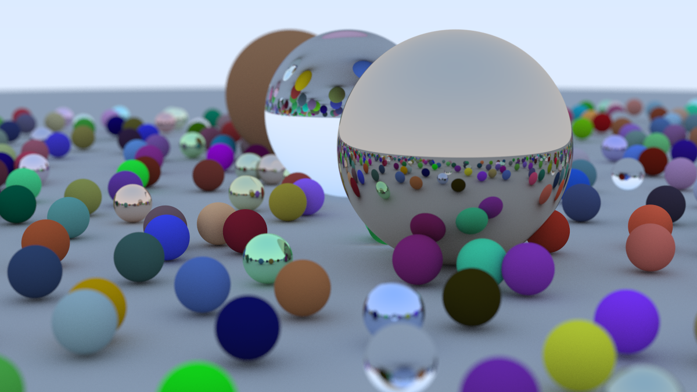

This is from [Ray Tracing In a Weekend](https://raytracing.github.io/books/RayTracingInOneWeekend.html), a tutorial on ray tracing. I have tried to learn from it and make images as intructed from it from scratch, with possible modifications to the code that will be done later on to build upon what I have learned.

This is the sample image of what has been completed till date:
 
